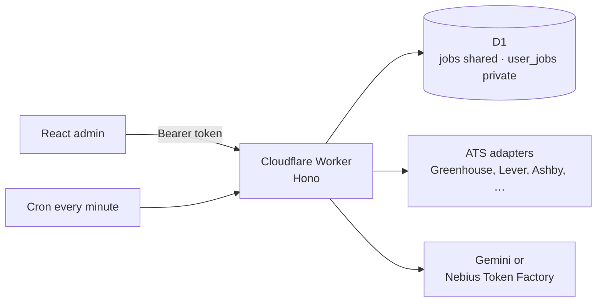

# JobRadar

**A job search you can run like a product, not like a spreadsheet.** JobRadar watches company career boards, keeps one shared catalog, and gives each person their own score, pipeline and notes. The ranking rules are a text profile they can edit. The model behind the score can be swapped only after a lab run has compared it with the one already in production.

Built end to end by [Leonid Kurdyukov](https://github.com/Levanidd): product scope, data model, ingest, scoring, the admin, and the model lab. It is the system he uses for his own search in Berlin, not a demo with fixture data.

- **Live:** https://jobradar.kurdyukov-leo-ger.workers.dev
- **Code:** https://github.com/Levanidd/JobRadar
- **Spec:** [`docs/SPEC.md`](docs/SPEC.md)

## The problem

A serious search is a pipeline. Which companies are worth watching, which titles even count, what "good" means for this person, and what happened after the click. Boards stop at the list. A chat can rank one posting and then forget it. Neither keeps a shared catalog and a private verdict, and neither lets you change the scoring model without guessing whether the new one is actually better.

JobRadar is that missing layer.

- **One catalog.** Company ATS boards and search sources are ingested, deduped and kept open or closed in one place. About 70 adapters, from Greenhouse, Lever, Ashby and Workday to Arbeitsagentur and a handful of company-specific boards.
- **A private verdict.** Score, status, notes, CV link and interview stages belong to the person. Two people can apply to the same posting and never see each other's pipeline.
- **Rules you can read.** Keep/drop tags and a company blacklist run in code, before any model call. Everything else the model is allowed to care about is the person's own profile text.
- **A way to change the model.** The lab replays postings the current scorer already judged, across several models and several repeats, and shows cost, stability and disagreement. Production data is not touched.

## What makes it different

| | JobRadar | A job board | Asking a chatbot |
|---|---|---|---|
| Live catalog, deduped across sources | Yes | One site, or a keyword search | No memory of the market |
| Score and pipeline per person | Yes, on the same posting | A bookmark | A chat transcript |
| Who decides "worth a ping" | The person's profile, editable | The board's ranking | Whatever was in the last prompt |
| Bad titles never reach the model | Prefilter in code | You filter by hand | The model reads everything |
| Change the model on purpose | Lab: same inputs, several models, a cost | No | Try another chat |
| Two people, one search | Shared boards, private applications | Separate accounts | Not a product |

## What to look at

Ten minutes in the code, in the order a review would actually go.

| Question | Where |
|---|---|
| Where does a posting stop being shared and become mine? | `migrations/0018_users.sql` — `jobs` vs `user_jobs` |
| What never gets sent to the model? | `prefilterAndScore` in `src/ingest.ts` |
| Where do the scoring rules live? | `scoringSystemPrompt` in `src/scoring.ts` |
| Why can the tab be closed mid-run? | `src/cycle.ts` — hops plus a cron resume |
| Why does a careers homepage often fail, and the ATS URL work? | `src/detect.ts` |
| How do you compare models without corrupting production? | `src/lab.ts` — snapshot the prompt, write only `lab_*` |

## How it works



1. **One posting, many verdicts.** `jobs`, `sources` and discovered companies are shared. Score, status, notes, CV link, interview stages and the profile live on `user_jobs` / `user_profiles`, keyed by `user_id`. Marking a job `applied` updates only that person's row. The other person's status, score and "Applied" list stay as they were.
2. **The model only sees what survived the person's own gates.** Keep/drop tags on the title and the company blacklist run in code, per user, before any LLM call. A title that fails the prefilter is parked as `off_profile` with score 0 and is never sent. A duplicate the same person already scored copies their old verdict instead of calling the model again.
3. **Scoring rules live in the profile, not in code.** `scoringSystemPrompt` inserts `user_profiles.content` and tells the model that this text is the only source of rules. Flag names and the JSON shape stay in the output contract (`FLAGS`, the response schema, `CHAT_JSON_HINT`). Production sends up to 10 clipped postings (8 000 characters of description) in one request. The provider, model and Gemini thinking level are global and chosen by the master. With no key, a local keyword heuristic scores instead.
4. **A run is a chain of short hops, not one request.** Ingest and scoring move in `waitUntil` slices (boards written 400 jobs at a time) so a hop fits the Worker budget. Cron (`* * * * *`) resumes a cycle that has not moved for 25 seconds, which is why the tab can be closed. The first pass of a source (`bootstrapped = 0`) does not notify.
5. **Detection reads the board the adapter can fetch, not the marketing page.** `POST /api/detect` looks for an ATS URL in the HTML (Greenhouse, Lever, Ashby, Workday, and the rest), then guesses a slug on the company domain. A careers page that paints the list in the browser, or a board whose slug is not the domain (`checkout.com`, `starling-bank`, `Superhuman Platform Inc`), is added by pasting the vendor URL directly.
6. **Lab measures the production prompt and writes nothing production reads.** A master samples up to 30 already-scored postings and replays each one, one request at a time, through up to 6 models and 5 repeats (300 trials). The profile and system prompt are snapshotted at creation, so a clone sends the same input. Lab writes only `lab_*` tables and one model-usage batch. Trials run 4 at a time; a compare-and-swap on `lab_runs.hops` keeps the tab, a new walker and cron from running the same hop twice. A trial the Worker drops before the model answers is retried, then kept as `timeout` ("попытка брошена воркером").

Sign-in is a personal token. The first login with `ADMIN_TOKEN`, while `users` is empty, creates the master and copies the current profile, scores and statuses. Issued tokens are stored as a hash; the master can show and rotate the plaintext of tokens they created. The token in the admin lives in `sessionStorage` for that tab.

## Stack

- **Cloudflare Workers + Hono.** `src/index.ts` only mounts routes, checks the token and catches errors. Domain code lives in `src/routes/`. The same Worker serves `admin/dist` through the assets binding; a static file wins when it exists, so `/api/*` still hits the Worker.
- **D1** (`job-scout`). Migrations in `migrations/` are applied by hand. They are not part of a code deploy.
- **React + Vite** admin. Tabs: Resources (Discovery, Explore, Sources), Jobs, Applied, Stats, Profile, Settings (master), Lab (master), Guide.
- **Scoring:** Google Gemini or Nebius Token Factory (OpenAI-compatible). The master picks the provider, model and thinking level in Settings. Every model call is logged (tokens, timing) and shown under Settings → Model requests.
- **Cron** resumes a stalled cycle and starts a run when a slot of the master's Europe/Berlin schedule is due.

## Run locally

Needs Node 20+ and npm.

```bash
git clone https://github.com/Levanidd/JobRadar.git && cd JobRadar
npm install
cp .dev.vars.example .dev.vars          # set ADMIN_TOKEN
npm test                                 # tsc --noEmit + vitest
npm run dev                              # http://127.0.0.1:43142
```

`GET /api/health` is the liveness check. For admin hot reload, keep `npm run dev` running and start `npm run admin:dev` (Vite on 5173, proxies `/api` to 43142).

Ingest and API tests boot SQLite in memory, apply the real migrations, and call the Worker through `app.fetch`, so the SQL is the SQL D1 runs. `npm run eval` scores 20 jobs and targets at most 3 mismatches.

A run starts from **Run** in the admin (`POST /api/run`) or from the auto-run schedule.

## Deploy

A push to `main` deploys. Workers Builds uses `npm run build`, then `npx wrangler deploy`.

`npm run deploy` is the path without git. It starts with `npm --prefix admin ci`, which deletes and reinstalls `admin/node_modules`. Slow locally, and it has hung after the work was already done.

After a migration is added:

```bash
npx wrangler d1 migrations apply job-scout --remote
```

### Configuration

| Secret | Required | Purpose |
|---|---|---|
| `ADMIN_TOKEN` | yes | Creates the first master. Later logins use personal tokens. |
| `GEMINI_API_KEY` | for Gemini | Scoring. `CHANGE_ME` counts as unset, and the heuristic runs instead. |
| `GEMINI_MODEL` | no | Default `gemini-3.7-flash`. The model saved in Settings wins over this secret. |
| `NEBIUS_API_KEY` | for Nebius | Token Factory scoring. `CHANGE_ME` counts as unset. |
| `TELEGRAM_BOT_TOKEN` + `TELEGRAM_CHAT_ID` | no | Digest. Currently off; without them, jobs stay in D1. |
| `ADZUNA_APP_ID` + `ADZUNA_APP_KEY` | no | Optional source. |

The Arbeitsagentur key is public and lives in code.

Every path except `/` and `/api/health` needs `Authorization: Bearer <personal token>`. Routes are mounted by domain from `src/routes/`. The contract is in [`docs/SPEC.md`](docs/SPEC.md).

## MCP

**Next release.** Not in this Worker yet. Spec: the JobRadar MCP requirements (Oct 21, 2026).

A separate Worker, `jobradar-mcp`, will sit beside this one and use the same D1. Claude connects over Streamable HTTP (`/mcp`) and logs in once with the person's existing JobRadar token (OAuth 2.1, PKCE, Dynamic Client Registration). `user_id` comes only from that token. No tool accepts it as an argument, and none of them run SQL.

Ten tools, five to read and five to write, all scoped to that person: search and list jobs, open one job, list applications, read the profile, set a status (`saved`, `applied`, `interview`, `rejected`, `ignored`), write `claude_comment`, save an `https` CV link, add an interview stage, update the profile. `new`, `notified` and `off_profile` stay owned by JobRadar. The catalog fields of `jobs` are readable. The old per-user columns still sitting on `jobs`, and `applied_history`, are not. CV files stay wherever the person keeps them. This server stores the link only.

Today `/api/mcp` on this Worker is a different thing: read-only SQL (`schema` and one `SELECT`) for the operator, with the same personal token. The next release does not extend it.

## Limits

- A scoring or ingest hop has to finish inside the Worker `waitUntil` budget (about 30 seconds). Lab walks stop starting new work at 25 seconds and hand the run back.
- Lab runs at most 300 trials, 4 at a time. A model that answers slower than the hop is dropped and retried up to 3 times, then marked `timeout`.
- The Telegram digest is off.
- Account deletion, a privacy policy, and revoking an MCP grant are part of the MCP release, not this one.
